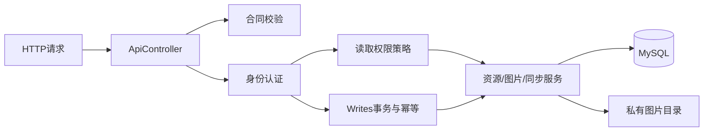

# 开发人员源码导读

每个源码目录的 `README.md` 说明该目录职责及当前内容；Java方法使用简短Javadoc，Swagger导航、Python生成器和PowerShell命名函数也有中文说明。

## 建议阅读顺序

1. `src/main/java/com/derm/ServerApplication.java`：应用启动。
2. `api/ApiController.java`、`api/Contract.java`：合同路由、认证入口和字段校验。
3. `auth/AuthService.java`、`auth/AccessPolicy.java`：登录、角色及资源读取范围。
4. `api/Writes.java`：账号锁、会话复核、幂等与事务提交。
5. `resource/ResourceService.java`、`resource/Records.java`：患者、病灶和采集的业务及持久化。
6. `resource/PatientDetails.java`、`resource/CaptureValidation.java`：资料展示与测量约束。
7. `storage/UploadService.java`、`storage/ImageFiles.java`：图片上传、校验、签名下载和私有文件。
8. `sync/SyncService.java`：个人快照、增量同步和导入范围。

上述路径除第一项外均相对 `src/main/java/com/derm/`。完整接口合同位于 `docs/backend/backend-v1.openapi.json`，构建时复制到JAR的 `contract/` 资源路径。

## 修改时注意

- 患者及医生读取权限与所有权写入校验分开；不要把医生全库读取权限套用到修改、上传和删除。
- 修改接口时同步维护合同、Swagger示例和前端交接文件。
- 已执行的SQL Flyway迁移保持原样，包括注释；Java迁移也不能修改已执行的业务逻辑。增加新版本迁移来修改结构或数据。
- 函数注释说明用途和关键约束，复杂的权限、事务、版本和同步规则保留在实现旁说明。
- 测试类以方法注释说明其验证的行为，测试辅助方法说明其构造的数据或请求。

## 构建与验证

使用现有 `scripts/mvn.ps1` 构建，不安装新的JDK或Maven。`test`运行默认H2测试；`scripts/test-mysql.ps1`仅重建 `derm_followup_test` 并验证现有MySQL。Swagger导航通过 `node --test src/test/js/swagger-navigation.test.cjs` 验证。

`docs/testing/generate_assets.py`生成联调样本和Postman集合；`scripts/build_frontend_handoff.py`生成前端快照、字段字典和交接ZIP。源码注释变更不需要重启服务，业务实现变更则应重新打包运行。

## 文件保留与清理

- `src/`、`scripts/`、`docs/`、`pom.xml`及运行入口是项目内容。
- `target/`是可重新生成的构建目录；保留当前可执行JAR和最新验证报告，历史调试日志、临时修改脚本及重复生成器可以清理。
- `.codex-build/mysql-dev/data`是开发实例的数据库数据，`.codex-build/backups`是备份，均不能当作构建缓存删除。
- `data/objects`是实际图片；`scripts/local.ps1`及本机凭据不可删除或提交。
- `.idea`保留本机运行配置；`.codex-build/m2`保留离线构建依赖，避免清理后需要重新下载。
- 前端交接ZIP与可编辑文档各有用途；保留两者，生成器可用于更新交接包。
